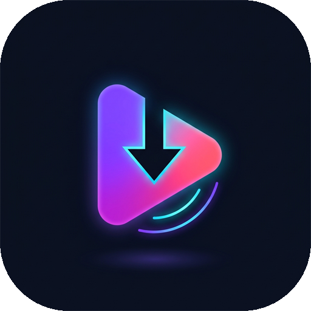

<p align="center">
  
</p>

<h1 align="center">UlgenTube</h1>

<p align="center">
  <strong>Reklamsız, %100 Ücretsiz, Modern Material 3 Android Medya İndirici & Oynatıcı</strong>
</p>

<p align="center">
  
  
  
  
  
  
</p>

**UlgenTube**, şeffaf paylaşım popup'ı (`SharePopupActivity`), dahili reklam engelli tarayıcısı, yüksek hızlı paralel indirme motoru ve yerleşik PiP video/müzik oynatıcısı ile çalışan; **YouTube, YouTube Music, Instagram, X (Twitter), Reddit, TikTok, Facebook, Pinterest, SoundCloud, Vimeo, Twitch, Kick ve 1.000+ siteden** video, müzik, albüm, altyazı ve galeri indirebilen tamamen reklamsız ve açık kaynaklı bir Android uygulamasıdır.

---

## İndirme (APK Sürümleri)

Hazır imzalı APK paketlerini [**GitHub Releases**](https://github.com/ulgenzade/UlgenTube/releases/latest) sayfasından indirebilirsiniz:

| Paket | Önerilen Cihaz |
| :--- | :--- |
| **`UlgenTube-v2.1.0-arm64-v8a.apk`** *(Önerilen)* | Modern 64-bit Android telefonların %95+'ı |
| **`UlgenTube-v2.1.0-armeabi-v7a.apk`** | Eski 32-bit ARM Android cihazlar |
| **`UlgenTube-v2.1.0-x86_64.apk`** | Emülatörler & 64-bit Intel/AMD tabletler |
| **`UlgenTube-v2.1.0-universal.apk`** | Tüm mimariler tek pakette |

---

## Öne Çıkan Özellikler

### İndirme & Motor
- **Hızlı YouTube Innertube + Yerel `MediaMuxer` Motoru**: 4K (`2160p`), 2K (`1440p`), `1080p60`, `HDR / 10-bit` (`AV1`, `VP9`, `H.264`) akışları ~0.4 saniyede çözümler, 25 GB'a kadar çok bağlantılı HTTP 206 Range ile indirir ve Android 10–15+ (`targetSdk 35`) SELinux kısıtına takılmadan yerel `MediaMuxer` ile kayıpsız birleştirir.
- **YouTube Music Albüm & Hızlı Playlist İndirme**: `music.youtube.com/browse/MPREb_...` albüm paylaşım linkleri, `OLAK5uy_` albüm listeleri ve `PL...` oynatma listelerini `WEB_REMIX` üzerinden ~0.4 saniyede çözüp tüm parçaları yüksek hızda indirir.
- **Instagram 3 Katmanlı Motor + Hikaye & Oturum**: Reels, gönderi, çoklu galeri, hikaye (`/stories/`), öne çıkanlar ve profil fotoğrafları için GraphQL/Story API + oturumlu WebView Sniffer + `yt-dlp`.
- **Reddit & 18+ (NSFW) Redgifs HD MP4 Desteği**: Sesli `v.redd.it` videoları, galeriler, crosspost gönderiler, `over18=1` desteği ve Redgifs v2 HD MP4 doğrudan çıkarıcı.
- **Altyazı (`.vtt`/`.srt`) & Akıllı Hafıza**: YouTube altyazılarını indirip dahili oynatıcıda otomatik tanır; son seçilen kalite ve ses dilini hatırlar; aynı dosya varsa *"İçeriği Göster / Yine de İndir"* uyarısı verir.
- **Duraklat / Devam Et & Çoklu Seçim**: Aktif indirmelerde tekil/toplu duraklat-devam et, uzun basarak çoklu seçim (Özel Kasaya Taşı / Toplu Sil), hız limiti, zamanlanmış indirme ve canlı depolama çubuğu.

### Oynatıcı, Stüdyo & Gizlilik
- **Dahili YouTube Tarzı Video Oynatıcı (Media3 / ExoPlayer)**: Android PiP (Resim İçinde Resim), CC altyazı seçici, kalite/hız/en-boy kontrolleri, çift dokunma atlama, kaldığın yerden devam ve indirmeden canlı önizleme (`▶`).
- **Mini Müzik Çalar & Ekolayzır**: Kuyruk yönetimi, sonraki/önceki, karıştır/tekrarla, arka planda video sesi çalma, 5 bantlı Ekolayzır/BassBoost ve senkronize LRC şarkı sözleri.
- **Çevrimdışı FFmpeg Medya Stüdyosu Pro (9 Araç)**: MP3'e çevir, WhatsApp/Discord sıkıştır, GIF oluştur, sesi kaldır, hızlandır/yavaşlat, video kırp, video birleştir, zil sesi olarak kaydet.
- **Özel Kasa & Uygulama Kilidi**: SHA-256 tuzlu PIN + biyometrik/cihaz kilidi ve `.nomedia` korumalı gizli kasa.
- **Dahili Tarayıcı & Uygulama İçi Hesap Girişi**: Reklam/yönlendirme korumalı tarayıcı sniffer'ı ve Instagram, YouTube, X, TikTok, Reddit için tam ekran yerel çerez oturumu.
- **5 Kategorili Ayarlar & Hata Teşhis Günlüğü**: Sadeleştirilmiş alt sayfalar, JSON yedekleme/geri yükleme ve hassas verileri maskeleyen tek tıkla kopyalanabilir/paylaşılabilir `.txt` teşhis raporu.

---

## Desteklenen Platformlar

| Platform | Video & Kalite | Sese Çevirme | Görsel / Galeri |
| :--- | :---: | :---: | :---: |
| **YouTube & YouTube Music** | 8K / 4K / 2K / 1080p • 60 FPS • HDR • Albüm & Playlist | MP3 / M4A / OPUS / FLAC / WAV | HD Kapak & Altyazı (`.vtt`) |
| **Instagram** | Reels, Post, Hikaye, Öne Çıkanlar + FFmpeg küçültme | MP3 / M4A / OPUS / FLAC / WAV | Fotoğraf, Galeri & Profil HD |
| **X (Twitter)** | Çoklu MP4 varyantları + GIF | MP3 / M4A / OPUS / FLAC / WAV | Tekil & Çoklu Fotoğraf |
| **Reddit** | Sesli Video, Crosspost, 18+ Redgifs HD MP4 | MP3 / M4A / OPUS / FLAC / WAV | Tekil & Çoklu Galeri |
| **TikTok / Facebook / Pinterest** | Filigransız HD Video / Pin Video | MP3 / M4A / OPUS / FLAC / WAV | Orijinal Görsel & Slayt |
| **Twitch / Kick / Vimeo / SoundCloud** | Klip, VOD & Kaynak Kaliteleri | MP3 / M4A / OPUS / FLAC / WAV | Kapak Görseli |
| **1.000+ Diğer Site** | `yt-dlp` + Dahili Tarayıcı Ağ Yakalayıcı | Tüm Ses Formatları | OpenGraph & Direkt Görseller |

---

## Teknoloji Yığını

- **Dil & Derleme**: Kotlin 2.0.21, Gradle Kotlin DSL, AGP 8.7.3, KSP, `minSdk 24` / `targetSdk 35`
- **UI**: Jetpack Compose, Material 3, Dynamic Color, Edge-to-Edge, Coil 2.7
- **Medya & Oynatma**: Android Native `MediaMuxer` / `MediaExtractor`, Media3 / ExoPlayer, `youtubedl-android` (`library`, `ffmpeg`, `aria2c`), OkHttp 4.12, Jsoup 1.18
- **Veri & Arka Plan**: Room 2.6 (v4), DataStore Preferences 1.1, Kotlin Coroutines & Flow, ForegroundService (`dataSync`)

---

## Derleme

```bash
git clone https://github.com/ulgenzade/UlgenTube.git
cd UlgenTube

# Birim testleri + arm64-v8a Release APK
./gradlew testDebugUnitTest assembleRelease -PabiFilter=arm64-v8a

# Tüm ABI'ler (arm64-v8a, armeabi-v7a, x86_64, x86, universal)
./gradlew assembleRelease -PsplitAbis=true
```

---

## Lisans

Bu proje [MIT Lisansı](LICENSE) altında lisanslanmıştır.
