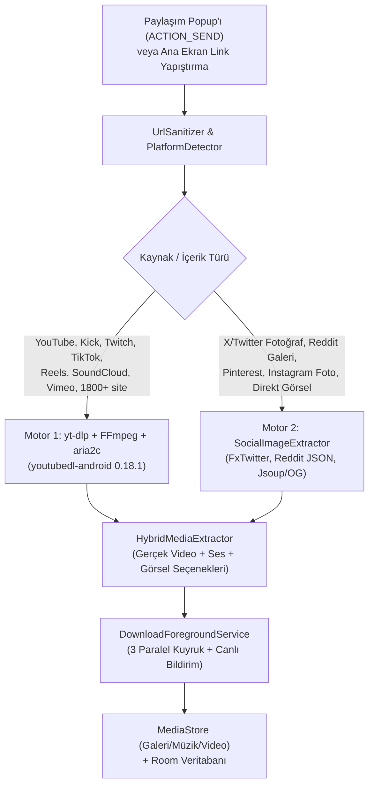

<p align="center">
  
</p>

<h1 align="center">UlgenTube</h1>

<p align="center">
  <strong>Reklamsız, %100 Ücretsiz, Modern Material 3 Expressive Android Medya İndirici</strong>
</p>

<p align="center">
  
  
  
  
  
</p>

**UlgenTube**, Snaptube tarzı anlık **Şeffaf Paylaşım Popup'ı (`SharePopupActivity`)** ile çalışan; YouTube, Kick, Twitch, Instagram, TikTok, X (Twitter), Facebook, Reddit, Pinterest, SoundCloud ve 1800+ siteden **video, müzik (ses) ve görsel/galeri** indirebilen tamamen reklamsız ve açık kaynaklı bir Android uygulamasıdır.

---

## Öne Çıkan Özellikler

- **Snaptube Tarzı Şeffaf Paylaşım Popup'ı**: Herhangi bir uygulamada **Paylaş → UlgenTube ile İndir** seçildiğinde mevcut uygulamanın üzerinde şeffaf `ModalBottomSheet` açılır; link otomatik analiz edilir, tek dokunuşla arka planda indirme başlar ve popup anında kapanır.
- **%100 Gerçek Kalite, FPS & HDR / Derin Bit Seçimi**: Sabit/sahte çözünürlük listesi yoktur. YouTube, Kick, Twitch vb. platformlarda kaynakta gerçekten ne varsa (`8K / 4K / 2K / 1080p`, `120 / 60 / 50 / 30 FPS`, `HDR / 10-bit`, `Yüksek Bitrate`, `AV1 / VP9 / HEVC / H.264`) birebir format ID'si ile en üst sıradan aşağıya listelenir.
- **Twitter/X & Instagram Kalite Seçimi + FFmpeg Küçültme**: Birden fazla varyant varsa tamamı listelenir; kaynak yalnızca tek çözünürlük sunuyorsa gömülü **FFmpeg** ile yalnızca orijinalden daha düşük çözünürlüklere (`720p / 480p / 360p`) gerçek ölçekleme yapılabilir.
- **Her Şeyde Sese Çevirme**: Video içeren her platformda `MP3 (320 / 192 / 128 kbps)`, `M4A (AAC)`, `OPUS`, `FLAC (Kayıpsız)` ve `WAV` dönüşümü + kapak görseli ve metadata gömme.
- **Görsel & Çoklu Galeri İndirme**: X/Twitter fotoğrafları (FxTwitter/VxTwitter API), Reddit galerileri (`.json`), Pinterest (`/originals/`), Instagram/genel web OpenGraph ve doğrudan görsel URL'leri için tekil veya "Tümünü İndir" toplu galeri indirme.
- **Hızlı & Dinamik Arka Plan Motoru**:
  - `aria2c` çoklu bağlantı hızlandırma
  - Ayarlar'dan tek tıkla uygulama içi **yt-dlp motor güncelleme**
  - `DownloadForegroundService` ile 3 paralel indirme, canlı hız/yüzde/ETA ve iptal aksiyonlu bildirim
  - `MediaStore` entegrasyonu ile doğrudan `Movies/UlgenTube`, `Music/UlgenTube` ve `Pictures/UlgenTube` klasörlerine kayıt
- **Modern Material 3 Expressive + Koyu/Gradient Arayüz**: Koyu/Açık/Sistem teması, Android 12+ Dinamik Renk (Material You), otomatik pano link algılama, filtreli indirme kütüphanesi.
- **Sıfır Reklam, Sıfır Takipçi**: Tamamen yerel cihaz üzerinde çalışır.

---

## Çift Motorlu (Hybrid) Mimari



---

## Desteklenen Başlıca Platformlar ve Formatlar

| Platform | Video & Kalite | Sese Çevirme | Görsel / Galeri |
| :--- | :---: | :---: | :---: |
| **YouTube & Shorts** | 8K / 4K / 2K / 1080p • 60 FPS • HDR / 10-bit | MP3 / M4A / OPUS / FLAC / WAV | HD Kapak Görseli |
| **Kick & Twitch** | Gerçek kaynak FPS & çözünürlükler | MP3 / M4A / OPUS / FLAC / WAV | Kapak Görseli |
| **Instagram** | Reels/Video orijinal + FFmpeg küçültme | MP3 / M4A / OPUS / FLAC / WAV | Fotoğraf & Önizleme |
| **X (Twitter)** | Çoklu MP4 varyantları + FFmpeg küçültme | MP3 / M4A / OPUS / FLAC / WAV | Tekil & Çoklu Fotoğraf |
| **TikTok** | Filigransız HD + FFmpeg küçültme | MP3 / M4A / OPUS / FLAC / WAV | Kapak Görseli |
| **Reddit** | HD Video + Ses birleştirme | MP3 / M4A / OPUS / FLAC / WAV | Tekil & Çoklu Galeri |
| **Pinterest** | Pin Video | MP3 / M4A / OPUS / FLAC / WAV | Orijinal (`/originals/`) |
| **Facebook / Vimeo / SoundCloud / 1800+ Site** | Desteklenen tüm akışlar | MP3 / M4A / OPUS / FLAC / WAV | Kapak / OpenGraph |

---

## Teknoloji Yığını

- **Dil & Derleme**: Kotlin 2.0.21, Gradle Kotlin DSL, Version Catalog (`libs.versions.toml`), AGP 8.7.3, KSP
- **UI**: Jetpack Compose, Material 3, Dynamic Color, Edge-to-Edge, Coil 2.7
- **Medya Motoru**: `io.github.junkfood02.youtubedl-android` (`library`, `ffmpeg`, `aria2c` `0.18.1`), OkHttp 4.12, Jsoup 1.18
- **Veri & Arka Plan**: Room 2.6, DataStore Preferences 1.1, Kotlin Coroutines & Flow, ForegroundService (`dataSync`)

---

## Kurulum ve Derleme

### Gereksinimler
- **JDK 17**
- **Android SDK 35** (`platforms/android-35`, `build-tools/35.0.0`)

### Projeyi Klonlama ve Derleme

```bash
git clone https://github.com/ulgenzade/UlgneTube.git
cd UlgneTube
```

`local.properties` dosyasını oluşturup kendi Android SDK yolunuzu ekleyin:
```properties
sdk.dir=/path/to/Android/Sdk
```

Birim testlerini çalıştırın ve Debug APK üretin:
```bash
# Windows
.\gradlew.bat testDebugUnitTest assembleDebug

# macOS / Linux
./gradlew testDebugUnitTest assembleDebug
```

Üretilen APK şu yolda oluşur:
```text
app/build/outputs/apk/debug/app-debug.apk
```

---

## Güvenlik

- `SharePopupActivity` yalnızca `ACTION_SEND` ve `text/plain` MIME tipini kabul eder; gelen metinlerden yalnızca `http://` ve `https://` şemalı bağlantılar ayıklanır (`file://`, `javascript:`, `intent://`, `content://` engellenir).
- Dosya adları path traversal (`..`, `/`, `\`) ve kontrol karakterlerine karşı `FileNameSanitizer` ile temizlenir.
- İndirilen dosyalar yalnızca `content://` (MediaStore) veya `FileProvider` URI'leri üzerinden `FLAG_GRANT_READ_URI_PERMISSION` ile paylaşılır.

---

## Lisans

Bu proje [MIT Lisansı](LICENSE) altında lisanslanmıştır.
